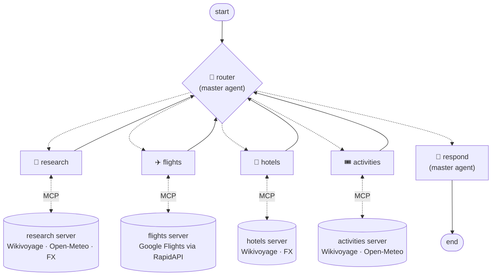

# 🗺️ AtlasPlanner

**A multi-agent travel planner built with LangGraph, Claude, and MCP.**

Tell it where you want to go. A supervisor agent splits the request across four
specialist agents (research, flights, hotels, activities), each with its own MCP
tool server and real data sources. It then combines their reports into a single
itinerary you can save as Markdown.

*Example session (reply abbreviated):*

```
You › Plan 4 days in Lisbon from JFK, March 3-7 2027. Mid-range budget, I love food and history.

  🔎  research agent reported back
  ✈️  flights agent reported back
  🏨  hotels agent reported back
  🎟️  activities agent reported back
╭──────────────────────────── 🗺️  AtlasPlanner ────────────────────────────╮
│ Trip overview · Flights · Where to stay · Day-by-day itinerary ·          │
│ Estimated budget · Tips                                                   │
╰───────────────────────────────────────────────────────────────────────────╯
You › /save lisbon
Saved to itineraries/lisbon-20270301-093000.md
```

## Features

- **Supervisor + specialists architecture.** A router agent picks the next
  specialist and hands it a specific task, using typed structured output rather
  than parsing text tags.
- **Live data, not placeholders**
  - ✈️ live flight prices (one-way and round-trip), condensed from ~200 KB of
    API JSON to the cheapest options
  - 🌦️ weather for your dates: a live forecast if the trip is within ~2 weeks,
    otherwise typical weather from the same dates last year
  - 💱 currency conversion at today's exchange rate
  - 📖 destination guides, neighbourhoods, sights and food from Wikivoyage
- **One MCP server per agent.** Each specialist only sees its own tools.
- **Persistent sessions.** Conversations are checkpointed to SQLite; pick up
  where you left off with `--session`.
- **Live progress in the terminal.** You can see which agent is working and on what.
- **Itinerary export.** `/save` writes the plan to a Markdown file.
- **Safety rails**
  - at most 4 specialist calls per turn, and no agent runs twice in a turn
  - tool loops are capped
  - the budget calculator uses an AST evaluator instead of `eval`
- **Graceful failure.** If an API is down, out of credits, or given bad input, the
  agents say so instead of crashing or inventing results.
- **Tests.** About 100 tests, 87% coverage, and no network or API key needed to run them.

## Architecture



### How one turn flows

1. **router** reads the conversation and returns a `RoutingDecision`:
   `{next_agent: "flights", task: "JFK→LIS round-trip 2027-03-03 to 03-07"}`.
2. The chosen **specialist** starts its MCP server and runs a tool loop with
   Claude (several rounds, with parallel tool calls). It then writes **one
   concise report** into the shared state. Raw tool calls stay local to the
   specialist, which keeps the shared context small.
3. Control returns to the **router**, which either calls another specialist or
   picks `respond`.
4. **respond** turns the reports into the final answer. It is told to use only
   facts that appear in the reports.

### Design decisions

| Decision | Why |
|---|---|
| Structured routing (`with_structured_output(..., method="json_schema")`) | Text tags like `route:flights` are brittle and leak into replies. Native structured output also works on newer Claude models, which reject forced tool choice. |
| Specialists return a report, not their tool transcript | Keeps the context small and lets every agent read the history without needing the other agents' tool definitions. |
| Reports are passed to the LLM as user-role messages | They are *inputs* to the next agent, and every request ends on a user turn, which newer models require. |
| One MCP server per agent | Least privilege: the flights agent can't call the currency tool by accident, and each server can be tested on its own. |
| Business logic in `tools/services/`, MCP servers are thin wrappers | The logic is plain Python functions that are easy to unit test. |
| `visited` list plus a hop limit | Guarantees each turn ends, even if the router misbehaves. |

## Data sources

| Agent | Tools | Source | API key? |
|---|---|---|---|
| Research | `destination_overview`, `weather_for_trip`, `convert_currency`, `calculate` | Wikivoyage, Open-Meteo, open.er-api.com | No |
| Flights | `search_roundtrip`, `search_oneway` | [Google Flights API on RapidAPI](https://rapidapi.com/) (`google-flights4`) | **Yes** (free tier) |
| Hotels | `where_to_stay`, `calculate`, `convert_currency` | Wikivoyage "Districts" + "Sleep" | No |
| Activities | `things_to_do`, `food_and_drink`, `weather_for_trip` | Wikivoyage "See/Do/Eat/Drink", Open-Meteo | No |

## Quickstart

Requires **Python 3.12+**.

```bash
git clone <your-repo-url> AtlasPlanner && cd AtlasPlanner
python -m venv venv && source venv/bin/activate
pip install -r requirements.txt

cp .env.example .env
# then edit .env:
#   ANTHROPIC_API_KEY=...      (https://console.anthropic.com)
#   RAPIDAPI_KEY=...           (subscribe to the "Google Flights" API on RapidAPI)
#   RAPIDAPI_HOST=google-flights4.p.rapidapi.com

python -m src.main
```

Everything except flight search works without the RapidAPI key.

### Usage

```bash
python -m src.main                     # start a new session
python -m src.main --session lisbon    # create or resume a named session
python -m src.main --verbose           # also show agent/tool logs
```

| Command | What it does |
|---|---|
| `/save [name]` | Save the latest plan to `itineraries/<name>-<timestamp>.md` |
| `/new` | Start a fresh session |
| `/help` | Show example prompts and commands |
| `/quit` | Exit (the session is saved automatically) |

Things to try:

- *Plan 5 days in Kyoto from SFO, April 10-15 2027. I love food and temples.*
- *What's the weather in Lisbon next week, and how much is 500 USD in euros?*
- *Find one-way flights JFK to LIS on 2027-03-03.*
- *Which neighbourhood should I stay in for nightlife in Barcelona?*

## Configuration

`config.yaml` controls the model shared by every agent:

```yaml
model:
  model: claude-sonnet-4-5
  temperature: 0.3     # optional; remove it for newer models that reject sampling params
  max_tokens: 4000
```

To try a newer model (for example `claude-sonnet-5-5`), change `model:` and delete
`temperature:`.

## Project structure

```
src/
├── main.py                    # CLI: streaming progress, sessions, /save
├── graph/
│   ├── state.py               # TravelState (messages, visited, next_agent, task)
│   └── workflow.py            # build_graph() / compile_app(checkpointer)
├── agents/
│   ├── master.py              # router_node (structured routing) + respond_node
│   ├── base.py                # shared specialist engine: MCP tools + tool loop
│   ├── messages.py            # how history is presented to each LLM call
│   └── research.py · flights.py · hotels.py · activities.py   # prompt + server per agent
├── tools/
│   ├── *_mcp_server.py        # one FastMCP server per agent (thin wrappers)
│   ├── shared_tools.py        # tools exposed by several servers
│   ├── mcp_helpers.py         # turns tool errors into messages the LLM can act on
│   ├── http_client.py         # timeouts + one error type for all HTTP calls
│   └── services/              # testable business logic
│       ├── flights.py · weather.py · currency.py · wikivoyage.py · calculator.py
└── utils/                     # config, llm factory + error messages, logging, itinerary export
tests/                         # pytest suite with fake LLMs and mocked HTTP
```

## Testing

```bash
pytest                                     # ~100 tests, no network or API key needed
pytest --cov=src --cov-report=term-missing # coverage (currently 87%)
```

The LLM is replaced by a scripted `FakeChatModel` (`tests/agents/fakes.py`), so the
full graph runs end to end in tests: routing, specialist reports,
checkpointed multi-turn memory, and error handling.

## LangGraph concepts used

This started as a project for learning LangGraph. Here's where each concept shows up:

- **`StateGraph` + custom state.** `TravelState` extends `MessagesState` with
  routing fields.
- **Reducers.** `messages` appends through `add_messages`; `visited` is overwritten
  and reset each turn.
- **Conditional edges.** `route_from_router` reads the router's decision from state.
- **Cycles.** Specialists loop back to the router until it picks `respond`.
- **Checkpointers.** `AsyncSqliteSaver` plus `thread_id` give each session
  persistent memory.
- **Streaming.** `astream(stream_mode="updates")` powers the live progress display.
- **Tools over MCP.** `langchain-mcp-adapters` loads FastMCP servers as LangChain tools.

## Limitations and ideas

- Hotel prices are **guide estimates** from Wikivoyage, not live availability. A
  booking API would be a natural next tool.
- Wikivoyage splits very large cities (Tokyo, London) into district articles, so the
  city-level "Sleep"/"Eat" sections can be thin there.
- The RapidAPI free tier has a monthly request limit.
- Ideas: stream tokens for the final answer, run independent specialists in parallel
  (LangGraph `Send`), add a human-in-the-loop confirmation before flight searches,
  add a web UI.

## Credits

- Travel guides: [Wikivoyage](https://en.wikivoyage.org/) (CC BY-SA 4.0)
- Weather: [Open-Meteo](https://open-meteo.com/) (CC BY 4.0)
- Exchange rates: [Rates By Exchange Rate API](https://www.exchangerate-api.com)
- Flights: Google Flights data via RapidAPI
